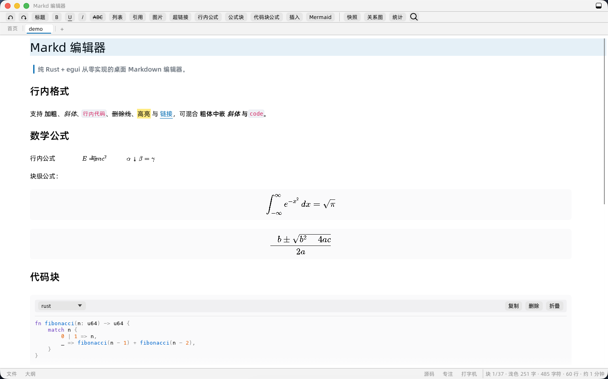
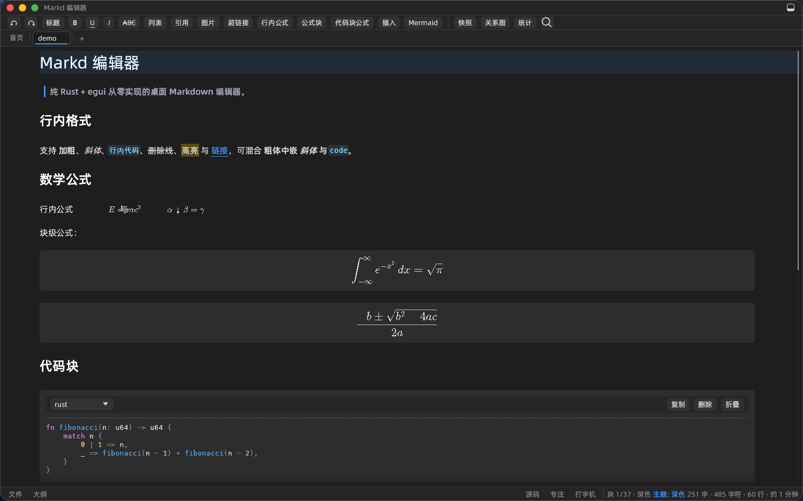

# Markd

[](./LICENSE)
[](https://github.com/whboy10000/markd/actions/workflows/build.yml)
[](https://github.com/whboy10000/markd/releases/latest)
[](#quick-start)

[简体中文](README.md) · **English** · [User manual](docs/MANUAL.md) (Chinese)

A desktop Markdown editor built from scratch in pure Rust + egui. No web kernel, no Tauri/Electron, no off-the-shelf editor component — from Markdown parsing to every pixel on screen, Markd draws it all itself.




## Why Markd

| Dimension | Markd | Electron / WebView editors |
| --- | --- | --- |
| Binary size | Single-file executable, 8–19 MB installers | 100 MB+, bundles Chromium |
| Memory | Native GUI, tens of MB | One Chromium process to start |
| Rendering | egui immediate mode, straight to GPU | DOM + CSS layout, layered indirection |
| Long documents | 10-million-character files stay editable (1.5 ms idle frame) | Scrolling / typing stutter is common |
| Parsing | In-house AST, lossless round-trip | Round-trip through HTML, format drift |

## Hybrid View

**The current block shows source; every other block renders live.** Click any paragraph to edit it — that block turns into Markdown source so you can edit characters precisely; move focus away and it returns to rich text. You keep the intuitiveness of WYSIWYG editors like Typora without auto-formatting "eating" details in your source file — indentation, blank lines and original marker order all survive untouched.

## Features

**Editing** Block-level WYSIWYG for headings, paragraphs, quotes, lists (including task lists), tables, code blocks, math, Mermaid, images, attachments (a lone `PDF` / `Word` / `Excel` link), footnotes, YAML front matter and `[TOC]`; continuous cross-block drag selection (the active block stays in edit mode so layout doesn't jump); right-click "Copy as / Paste as" for Markdown, plain text and HTML; 30+ shortcuts with `F1` cheatsheet; inline `==highlight==` as a first-class marker alongside bold, italic, strikethrough and inline code, fully nestable. The toolbar's line-break button drops a `<br>` at the caret — it forces a break in paragraphs, list items and table cells alike, and clicking into that block reveals the raw tag (partial-source mode). Insert → Embedded HTML drops `<span style="color:red; font-size:18px">` coloured text, a `<div style="background:#eee; padding:10px">` callout box or an `<hr>` rule into the body — the file stays plain Markdown and these tags are standard HTML; other renderers keep the tag semantics, but whether they apply the styles depends on the target renderer. An attachment is just a plain Markdown link in the file (other renderers keep reading it as a link) — Markd turns it into a file card: local files open in the system default app, remote ones download to `~/.markd/attachments` in the background and open when done.

**Markdown** ATX / Setext headings, ordered / unordered / nested lists, nested quotes, links, images, horizontal rules, hard breaks; GFM tables with alignment, strikethrough, task lists and fenced code blocks; super / subscript, autolinks and auto-numbered `[^1]` footnotes; top-of-file YAML front matter rendered as its own code-block panel, never mixed into the body.

**Math & diagrams** Inline `$...$`, display `$$...$$` and fenced `math` syntaxes; inline math aligns to the text baseline, display math is centered and scales down uniformly when too wide. RaTeX lays LaTeX out into a display list, lyon tessellates it and epaint `Mesh` draws it straight to GPU — **no PNG, no texture upload, no bitmap cache**; shapes are cached by (formula, font size, display mode). 25+ Mermaid diagram types (flowchart / sequence / gantt / mindmap / sankey / kanban / C4 and more) are all self-rendered — no mermaid.js.

**Code & workspace** In-house lexical highlighting: 10 colour families (Rust / Python / JavaScript / C-like / Markup / CSS / data formats / Shell / SQL / generic), per-language line and block comment syntax, and dedicated keyword tables for Dockerfile, Makefile, CMake, Terraform, Nginx, Lua, Haskell, Ruby, Go, LaTeX, MATLAB, Julia, R, Elixir, Clojure, Solidity and GraphQL. A 460+ row language dropdown where every spelling is its own entry — `cpp`/`c++`/`cxx`/`cc`, `dart`/`flutter`, `yaml`/`yml`/`k8s`/`github-actions` — clicking a row writes exactly that spelling into the fence, and aliases highlight identically. One-click copy, line numbers, current-line highlight. Folder workspaces scan with a 4,000-file / 60k-entry safety net, plus outline jumping, `Cmd/Ctrl+Shift+O` quick open, `[[wiki-link]]` backlink graph, full-text search, writing statistics, version snapshots and drag-to-open.

**Writing & terminal** Source mode, focus mode `F8` (only the current paragraph stays bright), typewriter mode `F9` (the editing line stays centered) and configurable auto-save. A PTY-based interactive shell supports colored output and alternate-screen apps (vim / less / htop); panel resizing syncs rows and columns (`SIGWINCH`). When the terminal has focus, every app shortcut except `Cmd/Ctrl+J` is handed to the shell.

**Export & appearance** Self-contained HTML export with CSS, math, highlighting, Mermaid and table styles all inlined — printable to PDF from any browser. A lone attachment link exports as a file bar with "Download" and "Open in new tab" (absolute local paths become `file://` URLs). Light / dark themes drive both syntax and math colors; a macOS native menu bar plus custom title bar; 220+ SVG icons embedded at compile time and rasterized once at runtime.

## Quick start

Download the installer for your platform from [Releases](https://github.com/whboy10000/markd/releases/latest):

| Platform | File | Notes |
| --- | --- | --- |
| macOS | `Markd-*-macos-intel.dmg` / `apple-silicon.dmg` / `universal.dmg` | Drag Markd into Applications; on "cannot verify developer" run `xattr -d com.apple.quarantine /Applications/Markd.app` |
| Windows | `Markd-*-windows-setup.exe` | Install wizard with optional directory; Start-menu and desktop shortcuts created automatically |
| Linux | `Markd-*-linux-amd64.deb` / `.rpm` / `.tar.gz` | `sudo dpkg -i Markd-*.deb` or `sudo rpm -i Markd-*.rpm`; or run the binary straight from the tarball |

Building from source requires **Rust 1.85+** (the workspace uses `edition = "2024"`):

```bash
cargo run -p markd                      # launch directly
cargo run -p markd -- path/to/note.md   # open a specific document
cargo build --release -p markd          # output: target/release/markd
```

Linux build dependencies:

```bash
sudo apt-get install -y libxkbcommon-dev libxcb-render0-dev libxcb-shape0-dev \
  libxcb-xfixes0-dev libxrandr-dev libxi-dev libgl1-mesa-dev libegl1-mesa-dev \
  libwayland-dev libgtk-3-dev
```

## Shortcuts

| Shortcut | Action |
| --- | --- |
| `Cmd/Ctrl + S` / `Shift + S` | Save / Save as |
| `Cmd/Ctrl + O` | Open file |
| `Cmd/Ctrl + Shift + O` | Quick open |
| `Cmd/Ctrl + N` | New document |
| `Cmd/Ctrl + P` | Command palette |
| `Cmd/Ctrl + 1 / 2 / 3` | Heading level 1 / 2 / 3 |
| `Cmd/Ctrl + B / I / K` | Bold / Italic / Link (paste URL in a popup) |
| ``Cmd/Ctrl + Shift + ` `` | Inline code |
| ``Ctrl + Shift + ` `` | Strikethrough |
| `Cmd + Option + C` / `B` | Code block / Math block |
| `Cmd + Option + T` / `Q` | Table / Quote |
| `Cmd + Option + O` / `U` | Ordered / Unordered list |
| `Cmd/Ctrl + /` | Toggle source mode |
| `Cmd/Ctrl + F` | Full-text search |
| `Cmd/Ctrl + Shift + L` | Show / hide sidebar |
| `Cmd + Ctrl + 1` | Show outline |
| `F8` / `F9` | Focus / Typewriter mode |
| `Cmd/Ctrl + J` | Show / hide terminal |
| `Cmd/Ctrl + Z` / `Shift + Z` | Undo / Redo |
| `Cmd/Ctrl + Shift + E` | Export HTML |
| `F1` | Shortcut cheatsheet |

## Architecture

A Cargo workspace with strictly one-way dependency flow:

```text
markd (bin)            entry point + icon resources
└─ markd-ui            app / editor / render / terminal / sidebar / icons
   └─ markd-platform   macOS native menu (muda) / font loading
      └─ markd-core    ast / document / command / export / workspace / image_host / theme
```

Inside `markd-ui`: `app/` state and action dispatch, `editor/` editor and viewport culling, `render/` block rendering, `terminal/` PTY, `sidebar.rs` file tree and search, `icons.rs` compile-time icons.

## Performance: measured on a 10-million-character file

Stress corpus: 10,000,045 characters / 17.6 MB / 241,046 blocks (headings, paragraphs, tables, code blocks, math and Mermaid mixed). Same file, same machine (macOS x86_64, release build, 1280 px viewport):

| Scenario | Before | Now |
| --- | --- | --- |
| Cold first frame | 13,862.9 ms | **34.8 ms** |
| Idle frame | 5,703.8 ms (worst 9,042.6) | **1.5 ms** (worst 4.0) |
| Scroll frame | 3,864.4 ms (worst 8,446.7) | **5.5 ms** (worst 9.0) |
| Keypress frame | 3,471.1 ms (worst 3,583.0) | **2.7 ms** (worst 8.3) |
| Shapes per frame | 754,878 | **182** |
| Resident memory | 3,152 MB | **271 MB** |
| Open pipeline | read 44 + parse 1,246 + outline 9.2 + stats 290 ms | read 44 + parse **553** + outline 4.2 + stats **0.5** ms |

The point of all of this is that **per-frame cost does not scale with document length**:

| Technique | Key numbers |
| --- | --- |
| Block layout table + viewport culling, 24 blocks of margin above and below, heights converge on measured values | Idle 1.5 ms, scroll 5.5 ms |
| Full parallel parse once on open, later keystrokes re-parse only the current block | 553 ms ≈ 18M characters/s |
| Undo stack stores splices (block index + old / new text); only a whole-document replacement degrades to a snapshot | 200 records 3,300 MB → 0.09 MB; 1M-char 200 records hold resident memory flat at 26 MB instead of climbing 29 → 388 MB |
| Per-block incremental statistics, summed instead of recomputed | 290 ms → 0.5 ms |
| Parallel search sharded across blocks with `min(cores, 8)` threads, byte-identical to serial | 93.9 ms → 20.9 ms |
| Syntax highlighting only for visible blocks | Warm frame 63.0 ms → 1.4 ms (100k-character corpus) |
| Source mode caches by revision and lays out only ~200 lines near the viewport, with spacers keeping scroll length | Cold frame 6.6 s → **460 ms**; per frame 113 ms → 15.7 ms |
| Virtualized sidebar lists | Backlink index 307 ms / 254 MB → 0.25 ms / 0.2 MB |
| Explicit-width layout, icons rasterized once, RaTeX zero rasterization | Three costs independent of document size |
| Lazy workspace, scanned in the background only when a panel opens | No synchronous scanning at startup |
| Dev builds optimize only dependencies with `opt-level = 3` | `cargo run` is day-to-day fast, own code stays debuggable |

Reproduce the measurements (they require `MARKD_STRESS=1`, so plain `cargo test` skips them):

```bash
MARKD_STRESS=1 MARKD_STRESS_TARGET=10000000 \
  cargo test --release -p markd-ui stress -- --nocapture --test-threads=1
```

Reference point at 1M characters / 24,420 blocks: open pipeline read 4.4 + parse 49.9 + outline 0.8 + stats 0.1 ms; idle 1.2 ms, scroll 4.0 ms, keypress 2.5 ms; 137 MB resident; HTML export 189.9 ms; full-text scan 2.6 ms parallel vs 9.9 ms serial.

Only two costs remain perceptible at the ten-million-character scale: typing in source mode costs about 950 ms per keypress (full re-parse) and HTML export takes about 1.9 s. Hybrid view opened on 10M characters: read 57 + parse 341 + outline 32 + stats 1 ms, first frame 88 ms.

## Configuration & fonts

Configuration and version snapshots live under `~/.markd/` in the user directory, never inside the project folder:

| Path | Purpose |
| --- | --- |
| `config.json` | Theme, font, font size, auto-save, image-host token, etc. |
| `folds.json` | Block fold state, keyed by absolute document path |
| `fonts/` | Custom fonts (Regular weight preferred) |
| `assets/` | Where inserted images are written locally |
| `snapshots/` | Version snapshots (time machine), indexed by `snapshots/index.json` |

Body text uses **Alibaba PuHuiTi 3.0** by default: detected automatically when installed; otherwise place the font file in `~/.markd/fonts/` or install it into a system font directory; if nothing is found it falls back to system fonts. Code blocks always use a monospace font.

## Build

GitHub Actions builds on macOS / Windows / Linux automatically (`.github/workflows/build.yml`): every push to `main` / `master` and every PR runs compile & tests with artifacts uploaded as Actions Artifacts; pushing a `v*` / `20*` tag creates a Release automatically — macOS produces Intel / Apple Silicon / universal DMGs (`scripts/package-macos.sh`, same logic locally and in CI), Linux produces `.deb` / `.rpm` / `.tar.gz`, and Windows produces an NSIS installer. CI runners are pinned (`ubuntu-26.04` / `macos-latest` / `windows-latest`) — we don't chase `*-latest` to avoid migration banners.

## License

This project is released under the [PolyForm Noncommercial License 1.0.0](LICENSE): any **noncommercial use** (personal study, research, hobby projects, use by charities / educational institutions / government bodies, etc.) may freely use, modify, and distribute the software; **commercial use requires separate authorization from the author**. See [`LICENSE`](LICENSE) for the full license text.

Copyright (c) 2026 aurelianus
