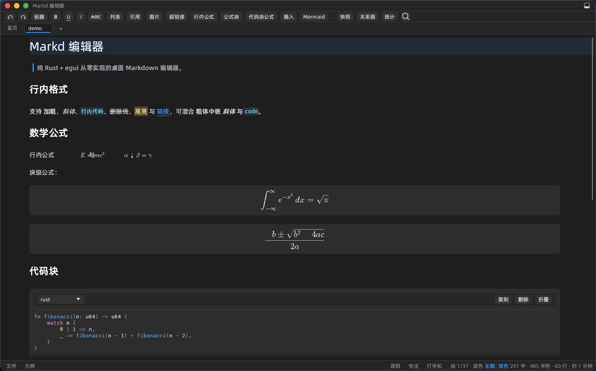

# Markd

[](./LICENSE)
[](https://github.com/whboy10000/markd/actions/workflows/build.yml)
[](https://github.com/whboy10000/markd/releases/latest)
[](#快速开始)

**简体中文** · [English](README.en.md) · [用户手册](docs/MANUAL.md)

纯 Rust + egui 从零实现的桌面 Markdown 编辑器。不套 Web 内核，不用 Tauri/Electron，不依赖现成的编辑器组件——从 Markdown 解析到屏幕上的每一个像素，都由 Markd 自己绘制。




## 为什么是 Markd

| 维度 | Markd | Electron / WebView 编辑器 |
| --- | --- | --- |
| 启动体积 | 单文件可执行，安装包 8–19 MB | 100 MB+，捆绑 Chromium |
| 内存占用 | 原生 GUI，几十 MB | 一个 Chromium 进程起步 |
| 渲染 | egui 立即模式，GPU 直出 | DOM + CSS 排版，间接层叠 |
| 长文档 | 1000 万字单文件可编辑（静置帧 1.5 ms） | 滚动 / 输入卡顿常见 |
| 解析 | 自研 AST，源码无损往返 | 经 HTML 中间层，格式易漂移 |

## Hybrid View

**当前块显示源码，其余块实时渲染。** 点击任意段落进入编辑态，那一块变回 Markdown 源码供你精确修改字符；焦点移开，立即回到富文本。既有 Typora 式 WYSIWYG 的直观，又不会被自动格式化「吃掉」源文件里的细节——缩进、空行、原始标记顺序都原样保留。

## 功能

**编辑** 标题、段落、引用、列表（含任务列表）、表格、代码块、公式、Mermaid、图片、脚注、YAML Front Matter、`[TOC]` 的全量块级所见即所得；跨块连续拖选（活动块在拖拽期间保持编辑态，布局不跳动）；右键「复制为 / 粘贴为」覆盖 Markdown、纯文本、HTML；30+ 快捷键，`F1` 随时速查；行内 `==高亮==` 与加粗、斜体、删除线、行内代码同级可嵌套。

**Markdown** ATX / Setext 标题、有序 / 无序 / 嵌套列表、嵌套引用、链接、图片、水平线、硬换行；GFM 表格（含对齐）、删除线、任务列表、围栏代码块；上下标、自动链接、`[^1]` 脚注自动编号；顶部 YAML Front Matter 按代码块面板独立渲染，不混入正文。

**公式与图表** 行内 `$...$`、块级 `$$...$$`、围栏 `math` 三种语法，行内按文字基线对齐、块级居中超宽等比缩小。RaTeX 把 LaTeX 排版成显示列表，lyon 细分后交给 epaint `Mesh` 直上 GPU——**无 PNG、无纹理上传、无位图缓存**；形状按「公式串 × 字号 × 显示模式」缓存。Mermaid 25+ 种图（flowchart / sequence / gantt / mindmap / sankey / kanban / C4 等）全部自绘，不调用 mermaid.js。

**代码与工作区** 自研词法高亮：10 个配色族、多种行注释与块注释语法、十几种语言专用关键字表；460+ 语言别名下拉，点谁写谁进围栏，高亮等价；一键复制、行号、当前行高亮。文件夹工作区按 4000 文件 / 6 万条目兜底扫描，配大纲跳转、`Cmd/Ctrl+Shift+O` 快速打开、`[[wiki-link]]` 双链关系图、全文搜索、写作统计、版本快照、拖拽打开。

**写作与终端** 源码模式、专注模式 `F8`（只高亮当前段落）、打字机模式 `F9`（编辑行居中）、可配置间隔的自动保存。PTY 交互终端支持彩色输出与备用屏（vim / less / htop），面板缩放自动同步行列（`SIGWINCH`）；终端聚焦时除 `Cmd/Ctrl+J` 外的应用快捷键让位给 shell。

**导出与外观** 自包含 HTML 导出，CSS、公式、高亮、Mermaid、表格样式全部内联，可直接用浏览器打印为 PDF；浅色 / 深色两套主题随语法与公式配色切换；macOS 原生菜单栏 + 自定义标题栏，220+ SVG 图标编译期嵌入、运行时一次栅格化。

## 快速开始

从 [Releases](https://github.com/whboy10000/markd/releases/latest) 下载对应安装包：

| 平台 | 文件 | 说明 |
| --- | --- | --- |
| macOS | `Markd-*-macos-intel.dmg` / `apple-silicon.dmg` / `universal.dmg` | 拖进 Applications；首次运行若提示「无法验证开发者」：`xattr -d com.apple.quarantine /Applications/Markd.app` |
| Windows | `Markd-*-windows-setup.exe` | 安装向导可选目录，自动创建开始菜单与桌面快捷方式 |
| Linux | `Markd-*-linux-amd64.deb` / `.rpm` / `.tar.gz` | `sudo dpkg -i Markd-*.deb` 或 `sudo rpm -i Markd-*.rpm`；也可直接解压二进制 |

从源码运行需要 **Rust 1.85+**（workspace 使用 `edition = "2024"`）：

```bash
cargo run -p markd                      # 直接启动
cargo run -p markd -- path/to/note.md   # 打开指定文档
cargo build --release -p markd          # 产物：target/release/markd
```

Linux 构建依赖：

```bash
sudo apt-get install -y libxkbcommon-dev libxcb-render0-dev libxcb-shape0-dev \
  libxcb-xfixes0-dev libxrandr-dev libxi-dev libgl1-mesa-dev libegl1-mesa-dev \
  libwayland-dev libgtk-3-dev
```

## 快捷键

| 快捷键 | 功能 |
| --- | --- |
| `Cmd/Ctrl + S` / `Shift + S` | 保存 / 另存为 |
| `Cmd/Ctrl + O` | 打开文件 |
| `Cmd/Ctrl + Shift + O` | 快速打开 |
| `Cmd/Ctrl + N` | 新建文档 |
| `Cmd/Ctrl + P` | 命令面板 |
| `Cmd/Ctrl + 1 / 2 / 3` | 一级 / 二级 / 三级标题 |
| `Cmd/Ctrl + B / I / K` | 加粗 / 斜体 / 链接（弹窗粘贴地址） |
| ``Cmd/Ctrl + Shift + ` `` | 行内代码 |
| ``Ctrl + Shift + ` `` | 删除线 |
| `Cmd + Option + C` / `B` | 代码块 / 公式块 |
| `Cmd + Option + T` / `Q` | 表格 / 引用 |
| `Cmd + Option + O` / `U` | 有序 / 无序列表 |
| `Cmd/Ctrl + /` | 切换源码模式 |
| `Cmd/Ctrl + F` | 全文搜索 |
| `Cmd/Ctrl + Shift + L` | 显示 / 隐藏侧边栏 |
| `Cmd + Ctrl + 1` | 显示大纲 |
| `F8` / `F9` | 专注 / 打字机模式 |
| `Cmd/Ctrl + J` | 显示 / 隐藏终端 |
| `Cmd/Ctrl + Z` / `Shift + Z` | 撤销 / 重做 |
| `Cmd/Ctrl + Shift + E` | 导出 HTML |
| `F1` | 快捷键一览 |

## 架构

Cargo workspace，依赖严格单向：

```text
markd (bin)            入口 + 图标资源
└─ markd-ui            app / editor / render / terminal / sidebar / icons
   └─ markd-platform   macOS 原生菜单栏（muda）/ 字体加载
      └─ markd-core    ast / document / command / export / workspace / image_host / theme
```

其中 `markd-ui` 细分：`app/` 状态与动作分发、`editor/` 编辑器与视口裁剪、`render/` 块级渲染、`terminal/` PTY、`sidebar.rs` 文件树与搜索、`icons.rs` 编译期图标。

## 性能：1000 万字单文件实测

压测语料：10,000,045 字符 / 17.6 MB / 241,046 个块（标题、段落、表格、代码块、公式、Mermaid 混排）。同一份语料、同一台机器（macOS x86_64，release 构建，视口宽 1280）：

| 场景 | 优化前 | 现在 |
| --- | --- | --- |
| 冷启动首帧 | 13,862.9 ms | **34.8 ms** |
| 静置一帧 | 5,703.8 ms（最差 9,042.6） | **1.5 ms**（最差 4.0） |
| 滚动一帧 | 3,864.4 ms（最差 8,446.7） | **5.5 ms**（最差 9.0） |
| 敲字一帧 | 3,471.1 ms（最差 3,583.0） | **2.7 ms**（最差 8.3） |
| 每帧绘制图元 | 754,878 | **182** |
| 常驻内存 | 3,152 MB | **271 MB** |
| 打开流水线 | 读盘 44 + 解析 1,246 + 大纲 9.2 + 统计 290 ms | 读盘 44 + 解析 **553** + 大纲 4.2 + 统计 **0.5** ms |

每帧成本与文档总长无关，靠这几件事做到：

| 手段 | 关键数据 |
| --- | --- |
| 块排版表 + 视口裁剪，上下各留 24 块余量，高度用实测值自我收敛 | 静置 1.5 ms、滚动 5.5 ms |
| 打开时全文并行解析一次，此后按键只重解析当前块 | 553 ms ≈ 1800 万字符/秒 |
| 撤销栈存 splice 差量（块号 + 旧文本 + 新文本），仅整篇替换退化为快照 | 200 条记录 3,300 MB → 0.09 MB；1M 字 200 条常驻 29→388 MB 压平到 26 MB |
| 统计按块增量求和，改一块只算一块 | 290 ms → 0.5 ms |
| 搜索按块分片并行（线程数取 `min(核数, 8)`），结果与串行逐字节一致 | 93.9 ms → 20.9 ms |
| 语法高亮只作用可见块 | 暖帧 63.0 ms → 1.4 ms（10 万字语料） |
| 源码模式按文档修订号缓存，并只排版视口附近约 200 行、上下占位撑开滚动区 | 冷首帧 6.6 s → **460 ms**；每帧 113 ms → 15.7 ms |
| 侧栏虚拟列表 | 双链索引 307 ms / 254 MB → 0.25 ms / 0.2 MB |
| 显式宽度排版、图标一次栅格化、RaTeX 零栅格化 | 三项成本与规模无关 |
| 工作区懒加载，仅在面板打开时后台扫描 | 启动不同步扫盘 |
| dev 构建只给依赖开 `opt-level = 3` | `cargo run` 可日用，自身仍可断点 |

复现压测（需显式设置 `MARKD_STRESS=1`，日常 `cargo test` 不会跑）：

```bash
MARKD_STRESS=1 MARKD_STRESS_TARGET=10000000 \
  cargo test --release -p markd-ui stress -- --nocapture --test-threads=1
```

中小体量参考（1M 字 / 24,420 块）：打开流水线读盘 4.4 + 解析 49.9 + 大纲 0.8 + 统计 0.1 ms，静置 1.2 ms、滚动 4.0 ms、敲字 2.5 ms，常驻 137 MB，HTML 导出 189.9 ms，搜索并行 2.6 ms / 串行 9.9 ms。

千万字量级仅有两处可感知代价：源码模式敲字约 950 ms/键（整篇重新解析）、HTML 导出约 1.9 s。混合视图打开 1000 万字：读盘 57 + 解析 341 + 大纲 32 + 统计 1 ms，首帧 88 ms。

## 配置与字体

配置与版本快照保存在 `~/.markd/`，不写入项目目录：

| 路径 | 用途 |
| --- | --- |
| `config.json` | 主题、字体、字号、自动保存、图床令牌等 |
| `folds.json` | 块折叠状态，按文档绝对路径记录 |
| `fonts/` | 自定义字体（优先 Regular 字重） |
| `assets/` | 插入图片写入的本地资产目录 |
| `snapshots/` | 版本快照（时间机器），索引在 `snapshots/index.json` |

正文默认使用 **阿里巴巴普惠体 3.0**：系统已安装会自动识别；未安装时可把字体文件放到 `~/.markd/fonts/`，或安装到系统字体目录；都找不到则回退系统中文字体。代码块始终使用等宽字体。

## 构建

GitHub Actions 在 macOS / Windows / Linux 三平台自动构建（`.github/workflows/build.yml`）：push 到 `main` / `master` 或提 PR 时编译并测试，产物上传为 Actions Artifacts；推送 `v*` / `20*` 标签时自动创建 Release——macOS 产出 Intel / Apple Silicon / 通用三种 DMG（`scripts/package-macos.sh`，本地与 CI 同一份逻辑），Linux 产出 `.deb` / `.rpm` / `.tar.gz`，Windows 产出 NSIS 安装程序。CI runner 版本固定（`ubuntu-26.04` / `macos-latest` / `windows-latest`），不追 `*-latest` 以避免迁移横幅。

## 许可

本项目基于 [PolyForm Noncommercial License 1.0.0](LICENSE) 发布：任何**非商业用途**（个人学习、研究、爱好项目、公益 / 教育 / 政府机构使用等）均可自由使用、修改与分发；**商业用途需要另行获得作者授权**。完整协议见 [`LICENSE`](LICENSE)。

Copyright (c) 2026 aurelianus
