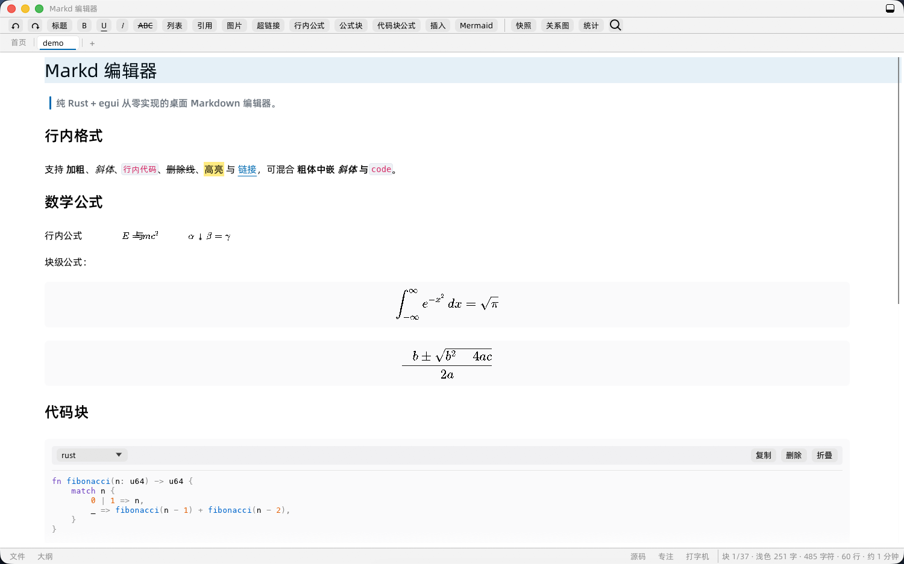

# Markd

[](./LICENSE)
[](https://github.com/whboy10000/markd/actions/workflows/build.yml)
[](https://github.com/whboy10000/markd/releases/latest)
[](#安装)

**简体中文** | [English](README.en.md)

完整的功能说明、使用场景、快捷键与逐项配置说明见 **[用户手册](docs/MANUAL.md)**。

纯 Rust + egui 从零实现的桌面 Markdown 编辑器。**不套 Web 内核，不用 Tauri/Electron，不依赖任何现成的编辑器组件** —— 从 Markdown 解析到屏幕上的每一个像素，都由 Markd 自己绘制。



<details>
<summary>深色主题</summary>


</details>

## 为什么是 Markd

| 维度 | Markd | 基于 Electron/WebView 的编辑器 |
| --- | --- | --- |
| 启动体积 | 单文件可执行，安装包 8–19 MB | 动辄 100 MB+，捆绑 Chromium |
| 内存占用 | 原生 GUI，几十 MB | 一个 Chromium 进程起步 |
| 渲染 | egui 立即模式，GPU 直出 | DOM + CSS 排版，间接层叠 |
| 长文档 | 1000 万字单文件可编辑（静置帧 1.5ms） | 大文档滚动/输入常见卡顿 |
| 解析 | 自研 AST，源码无损往返 | 经过 HTML 中间层，格式易漂移 |

## 核心概念：Hybrid View

**当前块显示源码，其余块实时渲染。** 点击任意段落进入编辑态，那一块变成 Markdown 源码让你精确修改字符；焦点移开，立即回到富文本。既保留了 Typora 这类 WYSIWYG 编辑器的直观，又不会被自动格式化「吃掉」源文件里的细节（缩进、空行、原始标记顺序）。

## 功能全景

### 编辑体验
- **Hybrid View 块级所见即所得**：标题、段落、引用、列表（含任务列表）、表格、代码块、公式、Mermaid、图片、脚注、YAML Front Matter、`[TOC]`。
- **跨块拖选**：鼠标从标题拖进段落、跨越代码块/图片/公式，选择框连续不破碎；活动块在拖拽期间保持编辑态避免布局跳动。
- **右键上下文菜单**：段落 / 格式 / 插入子菜单，剪切 / 拷贝 / 粘贴，「复制为 / 粘贴为」多种目标格式（Markdown、纯文本、HTML）。
- **完整快捷键体系**：标题级别、行内格式、块级插入、模式切换、命令面板等 30+ 快捷键（见下文表格），`F1` 随时呼出速查。
- **行内高亮 `==text==`**：与加粗、斜体、删除线、行内代码同级的原生标记，可嵌套可混合。

### Markdown 语法
- **基础**：ATX/Setext 标题、段落、有序/无序/嵌套列表、引用（支持嵌套块）、链接、图片、水平线、硬换行。
- **GFM 扩展**：表格（含对齐）、删除线、任务列表 `- [ ]` / `- [x]`、围栏代码块带语言标记。
- **行内格式**：`**粗**`、`*斜*`、`` `代码` ``、`~~删~~`、`==高亮==`、上/下标、`[链接](url)`、``、自动链接。
- **脚注**：`[^1]` 引用 + `[^1]: 内容` 定义，自动编号。
- **Front Matter**：顶部 YAML 块独立渲染，不混入正文。

### 数学公式（RaTeX 原生显示列表）
- **三种语法**：行内 `$...$`、块级 `$$...$$`、代码块 ` ```math ... ``` `。
- **零栅格化**：RaTeX 把 LaTeX 排版成显示列表（字形轮廓、贝塞尔路径、线段、矩形），Markd 用 lyon 按 NonZero / EvenOdd 环绕规则细分成三角形，交给 epaint `Mesh` 直接上 GPU。**没有 PNG、没有纹理上传、没有位图缓存**。
- **基线对齐**：行内公式嵌入文本流，按文字基线对齐；块级公式独占一行、居中，超宽时等比缩小。
- **显示模式**：行内自动用 `\textstyle`，块级用 `\displaystyle`，与 LaTeX 行为一致。
- **结果缓存**：按 `(公式串, 字号, 显示模式)` 缓存细分后的形状，每帧只是 Mesh 绘制。

### Mermaid 图表（25+ 类型，全自绘）
不调用 mermaid.js，每种图都有独立的 Rust 渲染器：
`flowchart`、`sequence`、`class`、`er`、`gantt`、`journey`、`gitGraph`、`mindmap`、`timeline`、`pie`、`quadrantChart`、`radar`、`sankey`、`treemap`、`xychart`、`kanban`、`C4`、`requirementDiagram`、`cynefin`、`packet`、`railroad`、`swimlane`、`blockDiagram`、`boxes` 等。

### 代码块
- 自研词法高亮，覆盖 Rust / Python / JavaScript / C 系 / Markup / CSS / 数据格式 / Shell / SQL 等 10 个语言家族。
- 一键复制、语言标签可切换、行号、当前行高亮。

### 工作区
- 打开文件夹 → 扫描 Markdown 文件树（带 4000 文件 / 6 万条目上限兜底）。
- 大纲面板：从标题层级生成，点击跳转。
- 快速打开 `Cmd/Ctrl+Shift+O`：模糊搜索工作区文件。
- 双向链接关系图：`[[wiki-link]]` 自动建图，可视化笔记互联。
- 全文搜索：跨文件关键词匹配。
- 写作统计：字数、段落、阅读时长。
- 版本快照（时间机器）：自动/手动快照，历史随时回看。
- 拖拽文件到窗口直接打开。

### 写作模式
- **源码模式**：纯文本编辑，不做渲染。
- **专注模式 `F8`**：只高亮当前段落，其余淡出。
- **打字机模式 `F9`**：编辑行始终保持在视口中央。
- **自动保存**：可配置间隔。

### 集成终端
- 基于 PTY 的交互式 shell（VS Code 风格），支持彩色输出与备用屏（vim / less / htop）。
- 面板缩放自动同步终端行列（`SIGWINCH`）。
- 终端获得焦点时，除 `Cmd/Ctrl+J` 外的应用快捷键让位给 shell。

### 导出
- **自包含 HTML**：内联 CSS，可直接用浏览器打印为 PDF。
- 公式、代码高亮、Mermaid、表格样式全部内联，无需外部资源。

### 外观
- **2 套主题**：浅色 / 深色，语法高亮与公式颜色随主题切换。
- **macOS 原生菜单栏** + 自定义标题栏：系统红绿灯右侧是命令面板 / 快速打开 / 搜索 / 保存 / 终端快捷按钮。
- 侧栏 220+ 个 SVG 图标编译期嵌入，运行时一次栅格化进纹理缓存。

## 安装

从 [Releases](https://github.com/whboy10000/markd/releases/latest) 下载对应安装包：

- **macOS**（三种架构任选其一）：
  - `Markd-*-macos-intel.dmg`：Intel 芯片
  - `Markd-*-macos-apple-silicon.dmg`：Apple Silicon（M 系列）芯片
  - `Markd-*-macos-universal.dmg`：通用二进制，两种芯片都能跑
  - 打开后把 Markd 拖进 Applications 即可。首次运行若提示「无法验证开发者」：`xattr -d com.apple.quarantine /Applications/Markd.app`。
- **Windows**：`Markd-*-windows-setup.exe`，安装向导里可选目录，会自动创建开始菜单与桌面快捷方式。
- **Linux**：
  - `Markd-*-linux-amd64.deb`：`sudo dpkg -i Markd-*.deb`
  - `Markd-*-linux-amd64.rpm`：`sudo rpm -i Markd-*.rpm`
  - 两者都会注册应用菜单项；也可以直接解压 `.tar.gz` 跑二进制。

## 运行

需要 **Rust 1.85+**（workspace 使用 `edition = "2024"`）。

```bash
# 直接启动
cargo run -p markd

# 打开指定文档
cargo run -p markd -- path/to/note.md
```

发布构建：

```bash
cargo build --release -p markd
# 产物：target/release/markd（Windows 为 target\release\markd.exe）
```

### Linux 运行依赖

```bash
sudo apt-get install -y libxkbcommon-dev libxcb-render0-dev libxcb-shape0-dev \
  libxcb-xfixes0-dev libxrandr-dev libxi-dev libgl1-mesa-dev libegl1-mesa-dev \
  libwayland-dev libgtk-3-dev
```

## 快捷键

| 快捷键 | 功能 |
| --- | --- |
| `Cmd/Ctrl + S` / `Shift + S` | 保存 / 另存为 |
| `Cmd/Ctrl + O` | 打开文件 |
| `Cmd/Ctrl + Shift + O` | 快速打开 |
| `Cmd/Ctrl + N` | 新建文档 |
| `Cmd/Ctrl + P` | 命令面板 |
| `Cmd/Ctrl + 1 / 2 / 3` | 一级 / 二级 / 三级标题 |
| `Cmd/Ctrl + B / I / K` | 加粗 / 斜体 / 链接（弹窗粘贴地址） |
| ``Cmd/Ctrl + Shift + ` `` | 行内代码 |
| ``Ctrl + Shift + ` `` | 删除线 |
| `Cmd + Option + C` / `B` | 代码块 / 公式块 |
| `Cmd + Option + T` / `Q` | 表格 / 引用 |
| `Cmd + Option + O` / `U` | 有序 / 无序列表 |
| `Cmd/Ctrl + /` | 切换源码模式 |
| `Cmd/Ctrl + F` | 全文搜索 |
| `Cmd/Ctrl + Shift + L` | 显示 / 隐藏侧边栏 |
| `Cmd + Ctrl + 1` | 显示大纲 |
| `F8` / `F9` | 专注 / 打字机模式 |
| `Cmd/Ctrl + J` | 显示 / 隐藏终端 |
| `Cmd/Ctrl + Z` / `Shift + Z` | 撤销 / 重做 |
| `Cmd/Ctrl + Shift + E` | 导出 HTML |
| `F1` | 快捷键一览 |

> 终端获得焦点时，除 `Cmd/Ctrl + J` 外的应用快捷键都会让位给 shell，避免打断交互式命令。

## 项目结构

Cargo workspace，依赖方向严格单向：

```text
┌─────────────────────────────────────────────────────────────┐
│ markd (bin)                                                 │  入口 + 图标资源
└─────────────────────────────────────────────────────────────┘
                          ▼
┌─────────────────────────────────────────────────────────────┐
│ markd-ui                                                    │
│  ├─ app/        应用状态、动作分发、对话框、菜单、标签栏    │
│  ├─ editor/     Hybrid View 编辑器、视口裁剪、选择、撤销    │
│  ├─ render/     块级渲染（含 math/diagram/inline）          │
│  ├─ terminal/   PTY 终端                                    │
│  ├─ sidebar.rs  文件树 / 大纲 / 搜索                        │
│  └─ icons.rs    220+ 编译期 SVG 图标                        │
└─────────────────────────────────────────────────────────────┘
                          ▼
┌─────────────────────────────────────────────────────────────┐
│ markd-platform                                              │  macOS 原生菜单栏（muda）/ 字体加载
└─────────────────────────────────────────────────────────────┘
                          ▼
┌─────────────────────────────────────────────────────────────┐
│ markd-core                                                  │
│  ├─ ast.rs        自研 Markdown AST                         │
│  ├─ document.rs   文档模型 + 撤销栈                         │
│  ├─ command.rs    Command 抽象（编辑/格式/插入/导航）       │
│  ├─ export.rs     HTML 导出                                 │
│  ├─ workspace.rs  工作区扫描 / 双链索引                     │
│  ├─ image_host.rs 图床上传                                  │
│  └─ theme.rs      主题与语法高亮配色                        │
└─────────────────────────────────────────────────────────────┘
```

## 性能：1000 万字单文件实测

压测语料：10,000,045 字符 / 17.6 MB / 241,046 个块（标题、段落、表格、代码块、公式、Mermaid 混排）。同一份语料、同一台机器（macOS x86_64，release 构建，视口宽 1280）：

| 场景（1000 万字） | 优化前 | 现在 |
| --- | --- | --- |
| 冷启动首帧 | 13,862.9 ms | **34.8 ms** |
| 静置一帧 | 5,703.8 ms（最差 9,042.6） | **1.5 ms**（最差 4.0） |
| 滚动一帧 | 3,864.4 ms（最差 8,446.7） | **5.5 ms**（最差 9.0） |
| 敲字一帧 | 3,471.1 ms（最差 3,583.0） | **2.7 ms**（最差 8.3） |
| 每帧绘制图元 | 754,878 | **182** |
| 常驻内存 | 3,152 MB | **271 MB** |
| 打开流水线 | 读盘 44 + 解析 1,246 + 大纲 9.2 + 统计 290 ms | 读盘 44 + 解析 **553** + 大纲 4.2 + 统计 **0.5** ms |

关键是**每帧成本与文档总长无关**：

- **块排版表 + 视口裁剪**（`editor/layout.rs`）。维护每块高度与顶边前缀和，一帧只排版落在视口内的块（上下各留 24 块余量）。高度用实测值自我收敛：未测量的块先用兜底值占位，一旦排版就替换成真实值，因此不会出现「估算高度与实测不符导致滚动条回弹」的老问题。
- **解析只做一次，编辑走增量**。打开时全文解析一次（553 ms ≈ 1,800 万字符/秒），之后每次按键只重新解析当前编辑的那一块；只有粘贴空行等把单块拆成多块的情况才回退一次全文解析。行内标记解析按块分片并行。
- **撤销栈存差量，不存整篇**。编辑记录以「块序号 + 旧文本 + 新文本」的拼接段（splice）入栈，只有整篇替换才退化为全量快照：1000 万字 200 条记录的栈占用从 **3,300 MB** 降到 **0.09 MB**，全量撤销 / 重做从 1,483 / 1,497 ms 降到 **0 ms 量级**；1M 字连做 200 条记录，常驻内存从「29 → 388 MB 线性上涨」压平成 **26 MB 不再增长**，全量撤销 2.0 ms 且无损还原。快照仍按 450 ms 节流、上限 200 组。
- **统计按块增量**（`Stats` 由每块统计量求和）。改一块只重算一块，1000 万字 290 ms → **0.5 ms**，并有与全量扫描逐字段对照的等价性测试。
- **搜索并行**。命中扫描按块分片，线程数取 `min(可用核数, 8)`，结果与串行逐字节一致（含命中上限）：1000 万字全文扫描 93.9 ms → **20.9 ms**。
- **语法高亮只作用可见块**。代码块暖帧 63.0 ms → **1.4 ms**（10 万字语料，下同）。
- **源码模式按修订号缓存**。整篇源码串、行首表、字符数、最长行宽度只在文档真的改过之后重算，行号只画视口内那几十行：1000 万字源码模式一帧 113 ms → **15.7 ms**。
- **侧栏虚拟列表**。双链目标索引 307 ms / 254 MB → **0.25 ms / 0.2 MB**。
- **与规模无关的三条照旧**：显式宽度排版（避免 `Label` 在横向布局退化成无限宽而每帧重排）、图标编译期嵌入且只栅格化一次、公式走 RaTeX 显示列表零栅格化。
- **懒加载的工作区**：文件树扫描有 4000 文件 / 6 万条目上限兜底；快速打开与双链关系图只在面板打开时后台扫描，绝不在启动阶段同步扫盘。
- **开发构建也够快**：`[profile.dev.package."*"] opt-level = 3` 只对依赖做全量优化，`cargo run` 直接可日用，自己代码仍可断点调试。

复现压测（需显式设置 `MARKD_STRESS=1`，日常 `cargo test` 不会跑）：

```bash
MARKD_STRESS=1 MARKD_STRESS_TARGET=10000000 \
  cargo test --release -p markd-ui stress -- --nocapture --test-threads=1
```

中小体量参考（1M 字 / 24,420 块，同一套探针）：打开流水线读盘 4.4 + 解析 49.9 + 大纲 0.8 + 统计 0.1 ms，静置一帧 1.2 ms（最差 3.2）、滚动 4.0 ms、敲字 2.5 ms，常驻内存 137 MB，HTML 导出 189.9 ms，全文搜索扫描并行 2.6 ms / 串行 9.9 ms。

已知代价，只在千万字量级才有感知：源码模式冷首帧 6.6 s（egui 对整篇 17.6 MB 文本一次性排版，此后每帧 15.7 ms）、源码模式敲字约 950 ms/键（整篇重新解析）、HTML 导出 1.9 s。默认的混合模式不受这三项影响。

## 配置

配置与版本快照保存在用户目录 `~/.markd/`，不写入项目目录。

```
~/.markd/
├── config.json      # 主题、字体、字号、自动保存、图床令牌等
├── folds.json       # 块折叠状态（按文档绝对路径记录）
├── fonts/           # 自定义字体（优先 Regular 字重）
├── assets/          # 插入图片时写入的本地资产目录
└── snapshots/       # 版本快照（时间机器），索引在 snapshots/index.json
```

## 字体

正文默认使用 **阿里巴巴普惠体 3.0**：系统已安装会自动识别；未安装时可以把字体文件放到 `~/.markd/fonts/`（优先加载 Regular 字重），或安装到系统字体目录。都找不到时回退到系统中文字体。代码块始终使用等宽字体。

## 构建

GitHub Actions 会在 macOS / Windows / Linux 三个平台自动构建（`.github/workflows/build.yml`）：

- push 到 `main` / `master` 或提 PR 时执行编译与测试；
- 编译产物上传为 Actions Artifacts，可直接下载运行；
- 推送 `v*` / `20*` 标签时自动创建 Release：macOS 产出 Intel / Apple Silicon / 通用三种 DMG（`scripts/package-macos.sh`，本地与 CI 同一份逻辑），Linux 产出 `.deb` / `.rpm` / `.tar.gz`，Windows 产出 NSIS 安装程序。

CI runner 版本固定（`ubuntu-26.04` / `macos-latest` / `windows-latest`），不追 `*-latest` 以避免 GitHub 迁移横幅。

## 许可

本项目基于 [PolyForm Noncommercial License 1.0.0](LICENSE) 发布：任何**非商业用途**（个人学习、研究、爱好项目、公益/教育/政府机构使用等）均可自由使用、修改与分发；**商业用途需要另行获得作者授权**。完整协议文本见 [`LICENSE`](LICENSE)。

Copyright (c) 2026 aurelianus
